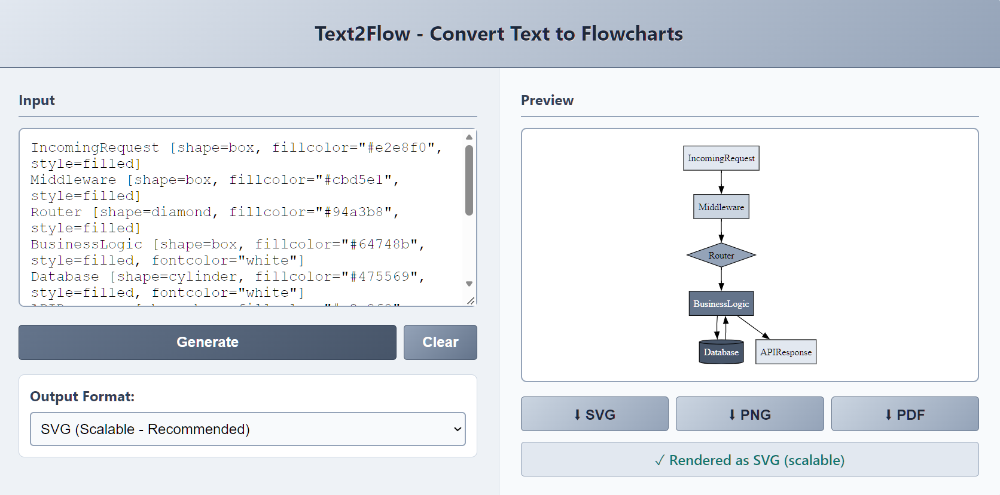
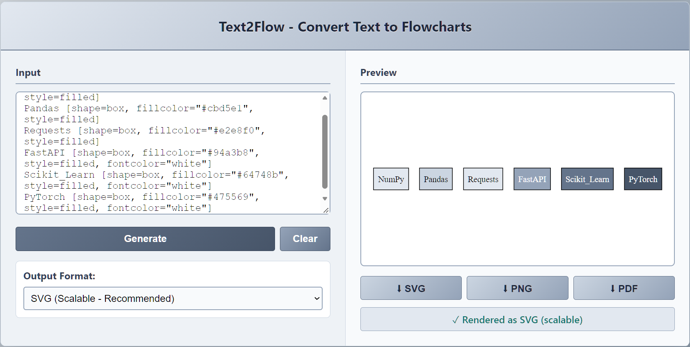

# 📊 Text2Flow


A lightweight, high-performance web application that converts simple text syntax into professional SVG/PNG flowcharts. Built with FastAPI and powered by the Graphviz visualization engine.

---

## 📑 Table of Contents

- [Why This Project Was Built](#-why-this-project-was-built)
- [Features](#-features)
- [Screenshots](#screenshots)
- [Getting Started](#-getting-started)
- [Installation](#️-installation)
- [How to Use](#-how-to-use)
- [Project Structure](#-project-structure)
- [Tech Stack](#-tech-stack)
- [Analysis](#-analysis)
- [Testing](#-testing)
- [Roadmap Features](#️-roadmap-features)

---

## 💡 Why This Project Was Built

`Text2Flow` eliminates the friction of complex drag-and-drop diagramming tools by letting you instantly compile simple text syntax (A -> B) into professional visual diagrams without leaving the keyboard.

---

## ✨ Features

- Instant Rendering: Convert text to diagrams in real-time.

- Simple Syntax: No complex drag-and-drop; just type A -> B.

- Clean API: Decoupled backend for programmatic diagram generation.

- Responsive UI: Minimalist editor with live preview.

---

## 📸 Screenshots

<details>
  <summary>click here</summary>
  
  <br>

  <table>
    <tr>
      <td align="center"><b>View 1</b></td>
      <td align="center"><b>View 2</b></td>
    </tr>
    <tr>
      <td></td>
      <td></td>
    </tr>
  </table>

</details>

---

## 🚀 Getting Started

### Prerequisites

- Python 3.8+

### Graphviz Software:
This app requires the Graphviz binaries 
to be installed on your system.

### Windows:

```text
Download here. Ensure you check "Add Graphviz to system PATH" during installation.
```

### macOS:
```bash
brew install graphviz
```

### Linux: 
```bash
sudo apt install graphviz
```

---

## ⚙️ Installation
Clone the repository:

```Bash
git clone https://github.com/reory/text2flow.git
cd text2flow
```

### Create and activate a virtual environment:

```Bash
python -m venv venv
# Windows
.\venv\Scripts\activate
# macOS/Linux
source venv/bin/activate
```

### Install dependencies:

```Bash
uv sync
```

### Run the server:

```Bash
uv run uvicorn app.main:app --reload
Open your browser to http://127.0.0.1:8000.
```

### Run the Desktop GUI app:

```bash
uv run python gui_app.py
```

---

## 🧠 How to use

<details>
  <summary>click here</summary>

The editor uses a simple arrow-based syntax (->) to define relationships between nodes.

```
Basic Flow
Plaintext
Start -> Process -> End
Branching & Decisions
You can create multiple paths by starting a new line with the same node name.
```

```
Input -> Validation
Validation -> Success
Validation -> Error
Success -> Database
Feedback Loops
Graphviz automatically handles the layout for circular logic.
```

```
Write_Code -> Run_Tests
Run_Tests -> Fix_Bugs
Fix_Bugs -> Run_Tests
Run_Tests -> Deploy
```

</details>

---

## 📁 Project Structure

```plaintext
text2flow/
├── app/
│   ├── main.py                # FastAPI entry point and middleware binding.
│   ├── routers/
│   │   └── api.py             # Programmatic API endpoints for diagram rendering.
│   ├── services/
│   │   ├── parser.py          # Syntax parser converting text lines into graph edges.
│   │   ├── renderer.py        # Graphviz wrapper compiling diagram components.
│   │   └── logger.py          # Centralized logging configuration.
│   ├── static/
│   │   ├── css/style.css      # Custom UI styling and layout sheets.
│   │   └── js/app.js          # Frontend asynchronous render and export logic.
│   └── templates/
│       └── editor.html        # Main Jinja2 editor interface markup.
├── screenshots/               # UI and feature preview images.
├── tests/                     # Comprehensive pytest test suites.
├── .gitignore                 # Git exclusion rules.
├── config.yaml                # Pyragify master code analysis template config.
├── gui_app.py                 # Tkinter-based desktop application entry point.
├── pyproject.toml             # Modern uv project and dependency metadata configuration.
├── uv.lock                    # Astral uv dependency lockfile.
├── LICENSE                    # MIT open-source license agreement.
├── README.md                  # Project overview, setup, and usage documentation.
└── CONTRIBUTING.md            # Guidelines for contributing to the repository.
```

---

## 🏭 Tech Stack

* **Backend: FastAPI (Python)**

* **Rendering: Graphviz**

* **Frontend: Vanilla JS, CSS3, HTML5**

* **Server: Uvicorn**

---

## 💻 Analysis

This repository includes a config.yaml for use with **pyragify**. To generate a single-file codebase for analysis in LLMs like NotebookLM, run:

```bash
uv run python -m pyragify --config-file config.yaml
```

---

## 🧪 Testing

Type pytest in the terminal

```bash
uv run pytest
```
---

## 🛣️ Roadmap Features

<details>
  <summary>click here</summary>

- [x] Export to PDF: Generate print-ready documents of the flowcharts.

- [x] Multi-Engine Layouts: Introduce a UI dropdown to switch between alternative `Graphviz` layout engines

- [ ] Theme Preset Engine: Pre-load built-in color palettes and styling presets (e.g., Cyberpunk, Solarized, Pastel, or Classic Dark Mode) to beautifully style entire diagrams instantly without typing manual hex codes.

- [ ] CLI Batch Processing Tool: Expose a command-line interface command (text2flow render input.txt -o output.pdf) so developers can automate diagram generation directly inside their build scripts or CI/CD pipelines.

- [ ] Real-time Live Preview: Implement an asynchronous "render-as-you-type" mechanism with a smart debounce timer, updating the canvas dynamically as the user modifies text without requiring a manual button click.

- [ ] Export as Clean, Layered SVGs: Structure generated `SVG` exports with clean, grouped CSS classes and layer IDs so users can easily open and tweak vector elements in external design tools.

</details>

---

* **Built by Roy Peters** 🙂
[](https://www.linkedin.com/in/roy-p-74980b382/)


